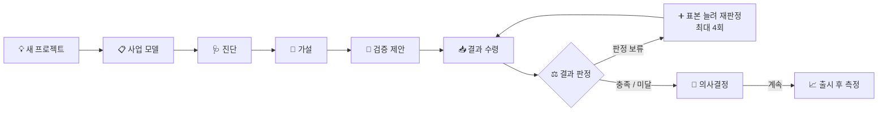

# 2026-AI-hackathon
<div align="center">

# 🔁 Loopit

**만들기 전에 검증하고, 증거로 판정받는다.**

AI 제품을 만드는 팀이 *틀리면 끝나는 가정*을 찾아 실험으로 확인하고,<br>
그 결과로 **계속 · 수정 · 중단**을 결정하도록 돕는 웹 서비스


[왜 만들었나](#-왜-만들었나) · [동작 방식](#-동작-방식) · [판정 원칙](#-판정-원칙) · [시작하기](#-시작하기) · [구조](#-시스템-구조)

</div>

---

> [!IMPORTANT]
> **AI는 가정을 찾고 초안을 쓰는 데만 쓰고, 판정은 코드가 계산합니다.**
> LLM은 점수도 판정도 내지 않습니다. 팀이 돌려준 실험 결과를 통계 코드가 판정합니다.

## 🎯 왜 만들었나

| 문제 | 결과 |
| --- | --- |
| AI로 제품을 만들기는 쉬워졌지만, 고객이 정말 AI에 맡기고 싶은지, 범용 AI가 곧 같은 일을 하지 않을지, 운영비를 감당할지는 만들기 전에 알기 어렵다 | 확인 없이 만든다 |
| 설문 답과 칭찬은 실제 행동과 다르고, AI에게 물으면 듣기 좋은 말을 돌려주기 쉽다 | 잘못된 확신이 생긴다 |
| 틀렸다는 사실을 시간과 돈을 다 쓴 뒤에 안다 | 비용이 커진다 |

**타깃** 🚀 AI로 제품을 만드는 초기 스타트업 팀 (2차: 사내 신사업팀, 액셀러레이터) · 🇰🇷 한국어만 지원

## 🔄 동작 방식



| 단계 | 🔁 Loopit이 하는 일 | 👥 팀이 하는 일 |
| --- | --- | --- |
| **진단 · 가설** | 사업 모델 추출, AI 특화 진단, 위험한 가정 목록 | 가정 확인·수정, 중요도 평정 |
| **검증 제안** | 실험·MVP 기획서 (방법, 실행 가이드, 표본 크기, 통과 기준, 결과 제출 폼) | 기획서대로 실험 실행, 원자료 수집 |
| **결과 분석** | 결과 수령, 증거 강도 평가, 3갈래 판정, 다음 행동 권고 | 결과 제출, 최종 결정 |

## ✨ 주요 기능

| | 기능 | 설명 |
| --- | --- | --- |
| 📋 | **사업 모델 추출** | 아이디어 글·웹사이트·피치덱·사진에서 Lean Canvas 9칸과 대신할 업무 목록 초안 생성 |
| 🩺 | **AI 특화 진단** | 업무별 자동화 수요 4구역, 대체 위험 등급, AI 운영비 계산 |
| 🧩 | **가설 도출** | 사전 부검으로 위험 가정 추출, 반대 평가자 의견, 블라인드 중요도 평정 |
| 📝 | **검증 기획서** | 목표값·최소 허용치 잠금, 필요 표본 수와 결정표가 담긴 PDF |
| ⚖️ | **결과 판정** | 증거 수준 평가, 가명 처리, 품질 경고, 3갈래 판정과 신뢰구간 |
| 📈 | **출시 후 측정** | PostHog · Amplitude · Langfuse 연동으로 같은 규칙에 따라 자동 재판정 |
| 🛠️ | **팀 협업·운영** | 대시보드, 팀원·외부 평가자 초대, 알림, 운영자 화면(`/admin`) |

## ⚖️ 판정 원칙

판정은 모두 코드(`src/lib/stats`, `src/lib/domain`)가 계산합니다. 기준은 결과를 보기 **전에** 잠기고, DB 트리거가 잠긴 기준의 변경을 막습니다.

### 3갈래 판정

성공 수 *k*, 표본 수 *n*에 Jeffreys 사전분포를 써서 실제 비율 *p*의 사후분포를 구합니다.

$$p \mid k, n \sim \mathrm{Beta}(k + 0.5,\; n - k + 0.5)$$

| 판정 | 조건 |
| :---: | --- |
| ✅ **충족** | P(p > 목표값) ≥ 0.8 |
| ❌ **미달** | P(p < 최소 허용치) ≥ 0.8 |
| ⏸️ **판정 보류** | 둘 다 아님 → 표본을 늘려 재판정 |
| ❔ **결론 없음** | 4회째 판정에도 보류 |

보고용 95% 신뢰구간은 Wilson 방식으로 함께 제공하고, 같은 회사에서 여러 명이 답하면 군집 보정(ICC)으로 유효 표본을 줄입니다.

### 증거 수준: 말보다 행동

| 수준 | 뜻 | 판정에 사용 |
| :---: | --- | :---: |
| **L0** | 미확인 | ❌ |
| **L1** | 진술 (설문·인터뷰 답) | ❌ 참고만 |
| **L2** | 관심 행동 (가짜 버튼 클릭 등) | ✅ |
| **L3** | 노력 (시간·데이터를 내놓음) | ✅ |
| **L4** | 지불 (선결제·유료 파일럿) | ✅ 지불 의향 가설은 L4만 인정 |

### 🔒 잠금과 재판정

- 목표값·최소 허용치는 잠근 뒤 바꿀 수 없고, 결과는 잠근 제안에만 낼 수 있습니다.
- 제안 하나에 결과는 하나입니다. 표본을 늘리려면 재판정 제안을 만들고, 처음 기준을 물려받아 사슬의 증거를 합쳐 판정합니다.
- 중요도 평정은 **블라인드**입니다. 내가 매기기 전에는 남의 평정·합의·순위가 보이지 않습니다.

## 🤖 AI(LLM) 활용 방식

LLM은 가정을 찾고, 근거를 정리하고, 기획서 초안을 쓰는 데만 씁니다. 응답 스키마에 점수 칸을 두지 않고, 숫자(비용·표본 크기·확률·판정)는 모두 코드가 계산합니다.

- **한 곳으로 호출** `src/lib/llm/client.ts`, 목적마다 프롬프트와 zod 응답 스키마가 짝으로 있음
- **형식 고정** Anthropic 구조화 출력 + zod 재검사, 실패하면 오류 내용을 붙여 한 번 더 요청
- **인용 검증** 인터뷰 인사이트의 인용이 원문에 실제로 있는지 문자열로 대조
- **전부 기록** 목적·프롬프트 버전·모델·토큰·비용·지연을 `llm_calls`에 저장
- **남용 방지** 프로젝트당 월 AI 사용 한도(기본 5만 원), 사용자당 시간당 120회
- **아첨 점검** 가상 아이디어 32개에 약점 45개를 심고 반박 60회를 던져, 듣기 좋은 말로 약점을 덮지 않는지 배포 전에 확인 (`npm run eval:sycophancy`)

## 🏗️ 시스템 구조

<div align="center">
  
</div>

브라우저는 DB에 직접 닿지 않고, 모든 요청이 Next.js 서버의 API 라우트에서 권한 확인을 거칩니다. 브라우저 · 고객 분석 도구 · 예약 작업 세 곳에서 요청이 들어옵니다.

## 🧰 기술 스택

| 영역 | 사용 기술 |
| --- | --- |
| 화면 · 서버 | Next.js 15.5 (App Router), React 19.1, TypeScript strict |
| 입력 검사 | zod 4.1 |
| DB · 인증 · 파일 | Supabase (PostgreSQL, Auth 이메일 링크, Storage) |
| AI | Anthropic Messages API (`claude-sonnet-5-5`, 기준선 테스트 `claude-haiku-5-5`) |
| PDF | @react-pdf/renderer + Noto Sans KR, unpdf |
| 테스트 | vitest, PGlite |
| 배포 | Vercel (서울 리전) 또는 Docker |

API 라우트 **88개** · DB 테이블 **48개**

## 🚀 시작하기

**준비물** Node.js · [Supabase](https://supabase.com) 프로젝트 · [Anthropic](https://console.anthropic.com) API 키

```bash
npm install
cp .env.example .env.local   # 키를 채운다
npm run setup                # 마이그레이션 7개 · 예시 프로젝트 · 저장소 버킷 (여러 번 실행해도 안전)
npm run doctor               # 키 · 연결 · 스키마 · AI 실제 호출 점검
npm run dev                  # 개발 서버
```

> [!TIP]
> 키 없이 화면만 보고 싶다면 `npm run dev:demo`
> Supabase 자리에 PGlite, Anthropic 자리에 고정 응답이 들어가 전체 흐름을 볼 수 있습니다.

<details>
<summary><b>🔑 환경 변수</b></summary>

<br>

| 변수 | 용도 | 필수 |
| --- | --- | :---: |
| `NEXT_PUBLIC_SUPABASE_URL`<br>`NEXT_PUBLIC_SUPABASE_ANON_KEY`<br>`SUPABASE_SERVICE_ROLE_KEY` | Supabase 접속 | ✅ |
| `ANTHROPIC_API_KEY`<br>`ANTHROPIC_MODEL`<br>`BASELINE_MODEL` | AI 호출 | ✅ |
| `DATABASE_URL` | `npm run setup` (Session pooler 주소 권장) | setup 때만 |
| `ENCRYPTION_KEY` | 연동 자격 증명 암호화 | 연동 사용 시 |
| `CRON_SECRET` | 매일 예약 작업 보호 | 예약 작업 사용 시 |
| `ADMIN_EMAILS` | 운영자 화면 접근 | 선택 |
| `RESEND_API_KEY`<br>`MAIL_FROM`<br>`VOYAGE_API_KEY` | 메일 알림, WORKBank 검색 | 선택 |
| `PROJECT_MONTHLY_LLM_BUDGET_KRW`<br>`LLM_CALLS_PER_HOUR` | 비용·호출 상한 | 기본값 있음 |

빈 값(`KEY=`)은 넣지 않은 것으로 보고, 선택 기능 키의 형식이 틀리면 그 기능만 꺼집니다.

</details>

## 🔌 외부 연동

필수는 Supabase와 Anthropic이고, 나머지는 키가 있을 때만 켜집니다. 모든 외부 호출은 서버에서만 하며 키는 브라우저로 나가지 않습니다.

| 서비스 | 용도 | |
| --- | --- | :---: |
| **Supabase** | DB, 이메일 링크 로그인, 파일 저장 | 필수 |
| **Anthropic** | 모든 LLM 호출 | 필수 |
| **PostHog** · **Amplitude** | 출시 후 지표의 분자·분모 이벤트 수 | 선택 |
| **Langfuse** | 실제 AI 비용을 계산기 가정과 비교 | 선택 |
| **Resend** | 알림 메일 (없으면 화면 알림만) | 선택 |
| **Voyage AI** | WORKBank 유사 업무 검색용 임베딩 | 선택 |

키를 맡기지 않으려는 팀은 **수신 토큰**(`vs_...`)으로 지표를 직접 보낼 수 있습니다.

```http
POST /api/ingest
Authorization: Bearer vs_...

{ "type": "metric", "event_name": "draft_accepted", "successes": 12, "n": 40,
  "period_start": "2026-10-01T00:00:00+09:00", "period_end": "2026-11-01T00:00:00+09:00" }
```

## 📡 API

화면이 하는 일은 모두 `/api` 아래 REST API로도 할 수 있습니다. 전체 목록은 **[docs/API.md](docs/API.md)** 를 보세요.

- **인증** 웹은 Supabase 로그인 쿠키, 다른 프로그램은 `Authorization: Bearer <Supabase access token>`
- **오류 형식** `{ "error": { "code", "message", "details"? } }`

## 🛡️ 보안

- 🚫 브라우저는 DB·저장소에 직접 닿지 않습니다. `anon`·`authenticated` 역할의 권한을 모두 회수했고, 모든 읽기·쓰기는 API 라우트가 역할(owner · member · external_rater · 운영자)을 확인한 뒤 service role로 합니다. RLS는 2차 방어선입니다.
- 🔒 잠금·재판정 규칙은 앱 코드뿐 아니라 DB 트리거와 고유 인덱스로도 지킵니다.
- 🕶️ 원자료는 가명 처리(이메일·전화·주민번호·사업자번호·이름·회사)한 뒤에만 저장하고, 보관 기간이 지나면 예약 작업이 지웁니다.
- 🔐 연동 API 키는 AES-256-GCM으로 암호화하고, 공개 https 주소만 받으며 내부망 주소는 접속 시점에 차단합니다(SSRF).
- ⏱️ 공개 주소와 LLM 호출에는 요청 수 제한이 걸려 있습니다.

## 📦 운영

**매일 예약 작업** `/api/cron/daily` (Vercel Cron 또는 crontab, 하루 1회, 약 4분 이내)

1. 보관 기간이 지난 원자료 삭제
2. 점검일·예상 기간이 지난 제안 알림
3. 오래된 요청 수 제한 기록 정리
4. 연동 도구에서 값을 가져와 재판정

**배포** Vercel(서울 리전 `icn1`, LLM 라우트 최대 300초) 또는 Docker(standalone 빌드, 앞단에 HTTPS 프록시와 `X-Forwarded-For` 필요)

- 배포 후 `npm run smoke`가 임시 사용자로 프로젝트 생성부터 결정까지 한 바퀴를 돌고 지웁니다.
- 프롬프트나 모델을 바꿀 때는 `npm run predeploy:check`를 통과해야 합니다.

<details>
<summary><b>📁 폴더 구조</b></summary>

<br>

```
src/app/                 화면(페이지)
src/app/api/             API 라우트 (권한 확인 후 서비스 함수 호출)
src/lib/services/        화면별 업무 로직
src/lib/stats/           3갈래 판정, Wilson, 결정표, 표본 크기, 군집 보정
src/lib/domain/          증거 수준, 4구역, 대체 위험, 중요도 합의, 권고
src/lib/cost/            AI 운영비 유닛 이코노믹스, 손익분기, Van Westendorp
src/lib/llm/             LLM 호출, 프롬프트·응답 스키마, 인용 검증, mock
src/lib/pii/             가명 처리
src/lib/integrations/    PostHog · Amplitude · Langfuse 어댑터
src/lib/net/, crypto/    내부망 차단 fetch, 자격 증명 암호화
supabase/migrations/     스키마, 규칙 트리거, 권한
scripts/                 setup, doctor, smoke, eval:sycophancy, predeploy:check, workbank:import
tests/                   단위 · DB · 통합 테스트
```

</details>

## 🧪 테스트

| 종류 | 명령 | 개수 | 보는 것 |
| --- | --- | :---: | --- |
| 단위 | `npm test` | 63 | 판정·비용·규칙 계산, 가명 처리, LLM 호출 형식 |
| DB | `npm run test:db` | 15 | 마이그레이션, 잠금·재판정 트리거, 권한 차단 |
| 통합 | `npm run test:integration` | 54 | 전체 흐름, 프로젝트 간 접근 차단, 동시 요청 |

**132개 모두 통과** (2026-10-24 기준). DB 서버 없이 PGlite로 실제 스키마·트리거 위에서 돌기 때문에 CI에서도 그대로 동작합니다.

## 🗺️ 남은 일

- [ ] 약관·개인정보 처리방침 법률 검토 (현재 초안)
- [ ] 아첨 점검: 전문가 2인 평가와 채점기용 사람 라벨
- [ ] 코딩 일치도 검증 (그전까지 인터뷰 인사이트는 모두 사람이 확정)
- [ ] WORKBank 상업적 사용 허락 (유료 판매 전)
- [ ] PostHog · Amplitude · Langfuse 실제 계정으로 연동 확인

## 📄 라이선스 · 데이터 출처

라이선스: _추가 예정_

WORKBank 데이터는 비상업적 용도로만 사용하며 출처를 표기합니다. 유료 판매 전에 저자 허락을 받습니다.

## 라이선스 / 데이터 출처

라이선스: _(추가 예정)_

WORKBank 데이터는 비상업적 용도로만 사용하며 출처를 표기한다. 유료 판매 전에 저자 허락을 받는다.
